# Atlas compliance audit: Home → Compliance Calendar → Workstream (Create and View)

Audited Nov 23, 2026 against `scenario-refinement` at `146aa74`, in Atlas Light, at 1440px wide. Screenshots are in `screens/`.

## How to read this

- **Scope:** every visible element on Home, the Compliance Calendar page and widget, the Workstream Create screen, the Workstream View screen (in progress), and the Cowork chat panel on the right. Hidden post-MVP views (task page, signal dialog, old create page) and the Demo settings dialog are out of scope.
- **Method:** I read the source of each screen and compared it with what the vendored `@diligentcorp/atlas-react-bundle` exports (components, theme keys, typography variants, tokens). I spot-checked the key claims in the bundle myself: the `StatusIndicator` colors and its dot variant, the `WelcomeMessage` slots, and the calendar's raw palette usage.
- **Rechecked against the Atlas MCP (Nov 23).** The first draft used only the bundle. I then read the Atlas component docs, design guidelines and `atlas-light` tokens for Status indicator, Alert, Card, Page header, Section header, Accordion, Chip, Popover, Tooltip, Menu, Dropdown, Badge, Welcome message, AI chat panel, AI tool calling and Typography. Findings that changed are marked **(rechecked)**. Several Atlas pages have no written guidance yet (Status indicator, Accordion, Section header, Legend, Collapsible text, Divider, Toast, Tooltip), so for those I could only check the code docs and tokens.
- **Our bundle is older than the docs.** `@diligentcorp/atlas-react-bundle` is the vendored Oct 30 copy. The docs describe an interactive `Card` (`interactive`, `href`) that this bundle does not have, so some fixes below need a bundle update first.
- **Effort:** S is under half a day. M is one to two days. L is more than two days, or needs a design decision or a new Atlas component.

## Summary

About 50 findings: most are small swaps (S) of a hand-built piece for an Atlas component or token, roughly a dozen are mid-size (M), and five have no Atlas equivalent (the status switcher, the date badge, the multi-line event chip, the task number badge and the muted event link), so they need a design decision or a new component.

The biggest pattern is that these Atlas components are not used anywhere on these screens: `Accordion`, `PageHeader`, `SectionHeader`, `WelcomeMessage`, `AIDisclaimer`, `AIChatPanel`, `AIChatToolCall`/`AIChatToolCallGroup`, and `AIChatSuggestedActions`. We hand-built a version of each one. The second pattern is the raw font-weight override (`fontWeight: emphasis`) on `body1`, `h4`, `h5` and `h6` at dozens of sites. Atlas's `label*` variants already carry that weight.

Your three examples hold up after the recheck, with one correction:

1. **The status switcher** is real, but it sits on each task block in View, not in the page header. The header status is a plain `StatusIndicator`. See W1.
2. **The calendar status dots** use raw core palette colors, not the Atlas `StatusIndicator` colors. See C1.
3. **The calendar date badges** have no Atlas equivalent. We also have three different versions of them. See C2 and C3.

---

## 1. Home

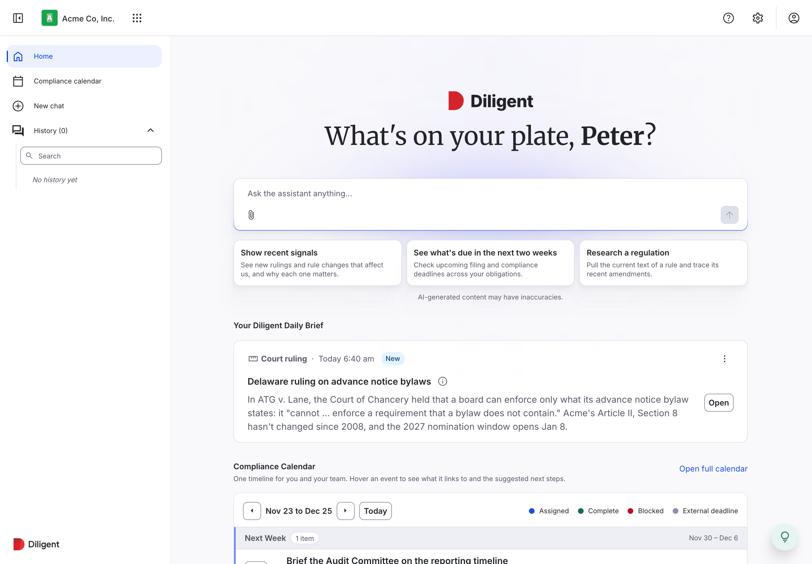

### H1. Hero headline and logo lockup **(rechecked)**
- **We have:** a hand-drawn SVG logo filled with raw `#D4232A` (`pages/IndexPage.tsx:26`). The wordmark and the Merriweather headline use raw sizes, weights and line height (`:43-74`).
- **Closest Atlas:** `WelcomeMessage({ greeting, logo, subtitle })`, which our bundle exports. The Atlas guideline describes exactly this block: the Diligent "D" mark and wordmark, a headline with the signed-in user's first name in bold, and an optional one-line subtitle. It is meant for the entry point of AI chat. The guideline's React status says "not yet available", so the bundle export may be ahead of the docs.
- **To comply:** pass `<b>Peter</b>, ...` style greeting copy and the logo as an element, then delete the raw font, size and color values. The guideline's example headline is "{First name}, what are we working on today?"; "What's on your plate, Peter?" is our own copy, so keep it only if you accept that difference.
- **Effort:** S–M. The New Chat hero (`CommandCenterChatHero.tsx`) has the same issue (S).

### H2. Hero glow
- **We have:** a `::before` radial gradient with raw `rgba(...)` and `blur(80px)` (`IndexPage.tsx:93-107`).
- **Closest Atlas:** `AIGlow` and the `aiGlow` tokens, or remove the effect.
- **Effort:** S.

### H3. Raw page spacing
- **We have:** `maxWidth: 960`, `py: 5` and raw `gap` numbers on the home page. Every other screen uses the `SPACE` scale.
- **Closest Atlas:** the `Container` export and `tokens.core.spacing`.
- **Effort:** S.

### H4. Composer and the AI disclaimer
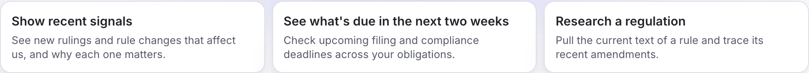
- **We have:** the Atlas composer's own disclaimer is forced hidden (`styles.css:84-88`, `display: none !important`), and a hand-made muted line says "AI-generated content may have inaccuracies." (`HomeQuickActions.tsx:79-85`).
- **Closest Atlas:** `AIDisclaimer`, or the composer's `slotProps.disclaimer`.
- **To comply:** show the Atlas disclaimer and delete the CSS override and the hand text.
- **Effort:** S.

### H5. Composer chrome overrides
- **We have:** the composer's glow and gradient border are hidden, and its shadow and radius are replaced (`AtlasChatBoxComposer.tsx:76`, `styles.css:73-82`). The replacements are tokens, but they are not the component's own.
- **Closest Atlas:** the default `AIChatBox` look.
- **Effort:** S, but it needs a design decision on whether the plain look is intentional.

### H6. Quick-action cards **(rechecked)**
- **We have:** Atlas `ClickableCard`. Atlas now marks it **deprecated** in favor of the interactive `Card` (`<Card interactive onClick | href>`). Inside it, we use `body1` with emphasis weight plus a `textMd` description, and sx that re-creates the layout (`HomeQuickActions.tsx:48-75`).
- **Closest Atlas:** interactive `Card`, with the documented `labelLg` title and `textSm` muted description. Our vendored bundle does not have the `interactive` prop yet, so this needs a bundle update first.
- **Effort:** S after the bundle update.

### H7. Attention card
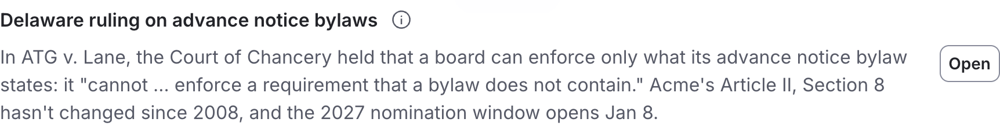
- **We have:** a plain MUI `Card` with `onClick`, a hand-written hover color and a 150ms transition (`AttentionPane.tsx:232-240`). It holds an overflow menu, an info tooltip button, an Open button and a link.
- **Closest Atlas:** interactive `Card` (`ClickableCard` is deprecated). Both say the content must not contain other interactive elements, so there is no exact match for a card with a menu and buttons inside.
- **To comply:** either make the card body an interactive `Card` and move the menu and Open button out of it, or keep the plain `Card` and document it as an exception.
- **Effort:** M, and needs a design decision.

### H8. Section headings and type
- **We have:** an `h6` with an emphasis-weight override for the section heading, and an `h5` used as a paragraph (regular weight, muted) for the card summary (`AttentionPane.tsx:89-96, 299-323`).
- **Closest Atlas:** `SectionHeader({ title, headingLevel })` for headings, and `body1` or `textMd` for the summary.
- **Effort:** S.

### H9. "Snoozed (n)" disclosure
- **We have:** a text button with `aria-expanded` toggling a list (`AttentionPane.tsx:130-169`).
- **Closest Atlas:** `Accordion`.
- **Effort:** S.

### H10. Side nav
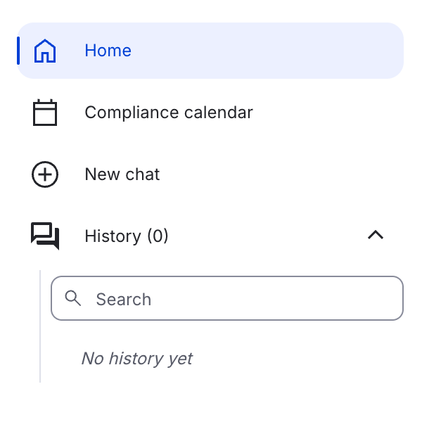
- **Compliant:** `AINavLink` and `AINavSection` from `global-nav`.
- **Deviations:** the History icon comes from `@mui/icons-material` (`ForumOutlined`), not Atlas icons (Atlas has `Message`, `AddMessage` and `History`) (S). The collapsed-rail button (`CommandCenterCompactNavButton`, a raw `Box component="button"`) and the nav search field have no Atlas equivalent.

### H11. Compliance Calendar widget on Home
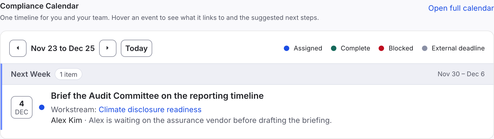
Same findings as section 2: C1 through C7.

---

## 2. Compliance Calendar

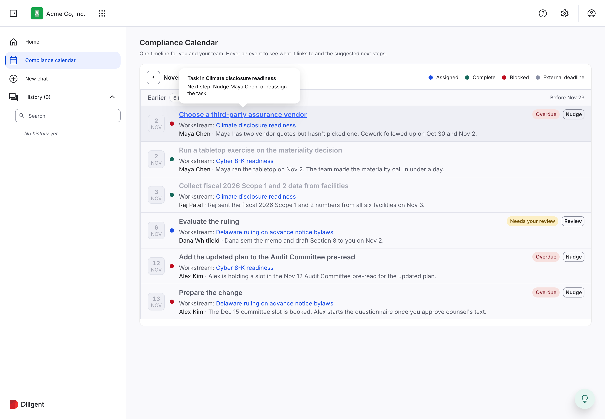

### C1. Status dots and legend (your example) **(rechecked)**
- **We have:** `StatusDot`, a hand-built 10px circle (`components/calendar/StatusDot.tsx`). It reads raw core palette shades: Assigned = `core.color.indigo[40]`, Complete = `moss[40]`, Blocked = `red[40]`, External = `storm[60]`. The legend (`CalendarLegend`) reuses them.
- **What Atlas prescribes (checked in `atlas-light` tokens):** `StatusIndicator` colors map to the accent pairs: information = `sky[30]` on `sky[95]`, success = `moss[40]` on `moss[95]`, error = `brick[35]` on `brick[90]`, warning = `curry[30]` on `curry[95]`, generic = gray accent. The semantic status tokens are `status.success.text` = `moss[40]`, `status.error.text` = `brick[35]` (default `brick[70]`), `status.neutral.text` = `concrete[35]`, and `status.new.default` = `indigo[40]`.
  - Complete (`moss[40]`) and Assigned (`indigo[40]`) match an Atlas value, but we reach them through the core palette instead of the status tokens.
  - Blocked (`red[40]`) matches no Atlas status color. Atlas error is `brick`.
  - External (`storm[60]`) matches no Atlas status color. Atlas neutral is `concrete`.
- **Closest Atlas:** `StatusIndicator` in its documented shape-only form (no label or icon, `aria-label` required), which renders a dot. Colors are `success`, `error`, `information`, `generic` and so on, or `customColor` with semantic tokens. With a `label` and `variant="shape"` it renders dot plus text, which is what the legend needs. The dot is 16px (`core.spacing[2]`) and pastel by default, larger and lighter than ours. Atlas also lists a `Legend` component in Figma, but it has no guidance and no React docs.
- **To comply:** replace `StatusDot` and the legend with `StatusIndicator`. Map Complete → `status.success`, Blocked → `status.error`, External → `generic` or `status.neutral`, and Assigned → `status.new` (indigo) or `information` (sky), which is your call. Use the pastel 16px dot, or `customColor` with the semantic `.text` tokens if you need the saturated dot on a row.
- **Effort:** M, and needs a design decision.

### C2. Date badge (your example)
- **We have:** `DateChip`, a 40px day-over-month badge with per-tense colors (`components/calendar/DateChip.tsx`).
- **Closest Atlas:** none. `Chip` and `badge` are single-line pills. The `calendar` theme key styles date-picker cells, which is a different thing.
- **To comply:** propose a date badge to Atlas, or reduce it to a `StatusIndicator` with a short date label ("Nov 2"). The second option loses the two-line shape from the Figma.
- **Effort:** L.

### C3. Three different date treatments
- **We have:** `DateChip` on timeline rows, a hand-built date pill in `SwimlaneBoard.tsx:170-182`, and a weekday/day/month heading in `CalendarCell.tsx:74-95`. They are inconsistent with each other.
- **To comply:** settle on the C2 decision, then unify.
- **Effort:** S after C2.

### C4. Month navigation (`TimeSelector.tsx`)
- **We have:** icon buttons styled by hand with a custom border and radius.
- **Closest Atlas:** an outlined icon `Button`, or `ButtonArray`.
- **Effort:** S.

### C5. Calendar panel container (`ComplianceCalendar.tsx:149-157`)
- **We have:** a `Box` with a border that borrows a button token (`action.secondary.outlineDisabled`).
- **Closest Atlas:** the `Card` export, or an outlined `Card`.
- **Effort:** S.

### C6. Page and widget header (`ComplianceCalendar.tsx:125-141`)
- **We have:** hand-built title (`h4`/`h6` with a weight override) plus muted description plus right-hand action.
- **Closest Atlas:** `PageHeader` for the page, `SectionHeader({ title, subtitle, buttonArray })` for the widget.
- **Effort:** S.

### C7. Time bands (Earlier, This Week, Next Week) (`TemporalBands.tsx`)
- **We have:** band backgrounds borrowed from `statusIndicator.colors.*`, raw `core.color.indigo[40]`/`[60]` accent bars, hand-built 3px borders, and an "N items" pill built from a `Box`.
- **Closest Atlas:** no band component. The count pill could be a `Chip` or a `StatusIndicator color="generic"`.
- **To comply:** use semantic tokens (such as `status.notification.*`) instead of core indigo, and `Chip` for the count.
- **Effort:** M.

### C8. Month-grid event chip (`CalendarCell.tsx:111-165`)
- **We have:** a multi-line button-chip with a dot and a three-line clamp. Cells also carry raw values (`opacity: 0.55`, `minHeight` 140/128, `lineHeight: 18px`).
- **Closest Atlas:** none. `Chip` is a single-line pill.
- **Effort:** M. Note the month grid is hidden in the Q4 release, so this only matters if it returns.

### C9. Hover popup on events (`TimelineItem.tsx:13-23, 157`) **(rechecked)**
- **We have:** a MUI `Tooltip` holding rich content (a bold label plus a next-step line).
- **Closest Atlas:** Atlas `Tooltip` is the themed MUI one, so the component is compliant. The Popover guideline describes a click-triggered container with an optional header and footer, not a hover one, so it is not a replacement. Atlas has no hover pattern for rich content, and the Tooltip guideline is empty.
- **Effort:** none required. Treat the rich content as a design question for Atlas.

### C10. Event title color (`TimelineItem.tsx:143-148`)
- **We have:** a `Link component="button"` with its color overridden to muted or disabled for done rows.
- **Closest Atlas:** none for a "muted link" state.
- **Effort:** S, and needs a design decision.

### C11. Month-grid weekday headings (`ComplianceCalendar.tsx:369-383`)
- **We have:** `textMd` with a weight override, uppercase, and raw `letterSpacing: 0.5px`.
- **Closest Atlas:** the `labelSm` or `labelXs` variants.
- **Effort:** S.

**Compliant:** the Overdue, Needs your review and Blocked pills (Atlas `StatusIndicator`), the Nudge and Review buttons (Atlas `xsmall` outlined), the view toggle (`ToggleButtonGroup`), and Today (outlined `Button`).

---

## 3. Workstream: Create

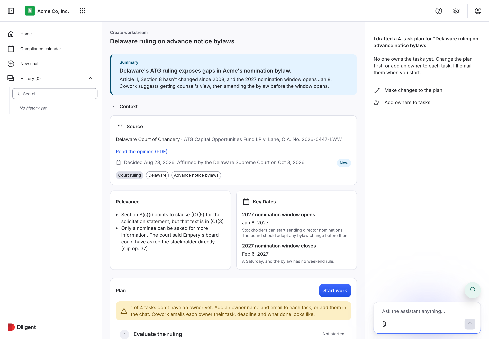

### W1. Page header (Create and View)
- **We have:** a local `PageHeader` function: a muted `textMd` eyebrow, an `h4` title with a weight override, and a baseline-aligned action slot (`pages/WorkstreamPage.tsx:443-461`).
- **Closest Atlas:** `PageHeader({ pageTitle, pageSubtitle, statusIndicator, buttonArray })`. It has a `statusIndicator` slot (View's status badge), a `buttonArray` slot (Create's Start work, which you moved into the Plan card; the guideline puts the most important action at the right of the header) and a breadcrumb slot. Our muted eyebrow ("Workstream", "Create workstream") is a stand-in for the breadcrumb, which the guideline says to include on any page below the top level. Keep titles under 60 characters and never in all caps.
- **Effort:** S–M.

### W2. Summary banner
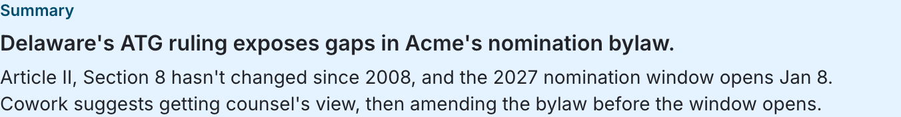
- **We have:** a hand-built panel with a 4px left accent bar. Background and bar colors come from `tokens.component.statusIndicator.colors[tone]` (`components/workstreams/StatusSummary.tsx:43-53`).
- **Closest Atlas:** `Alert` (info, warning, error severities, with a title and an action). The `alert` tokens already resolve to the same accent colors, so the colors match. The 4px bar is not part of Atlas `Alert`.
- **To comply:** use `Alert severity=... title=...` and drop the custom border and background.
- **Effort:** S–M. The same panel is used on View (see W9).

### W3. Context accordion **(rechecked)**
- **We have:** a `ButtonBase` plus `Collapse` plus a caret icon, with an `h6` heading (`WorkstreamPage.tsx:529-575`).
- **Closest Atlas:** `SectionHeader` with `isExpandable`, `isExpanded`, `onExpand` and `onCollapse` and the content as children. This is closer than `Accordion`, because the Context row is a section heading that expands. `Accordion` (the MUI `Accordion` with `AccordionPresets.components.Header`) is the fit for the per-task Activity rows.
- **Effort:** S.

### W4. Source, Relevance and Key Dates cards
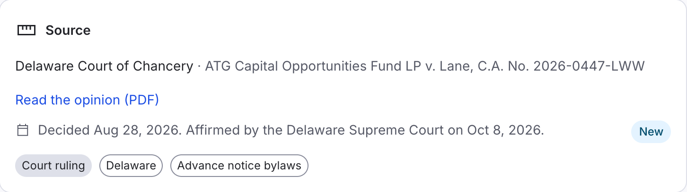
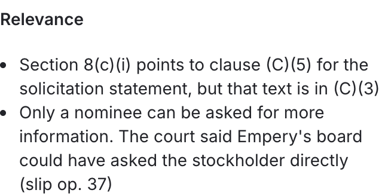
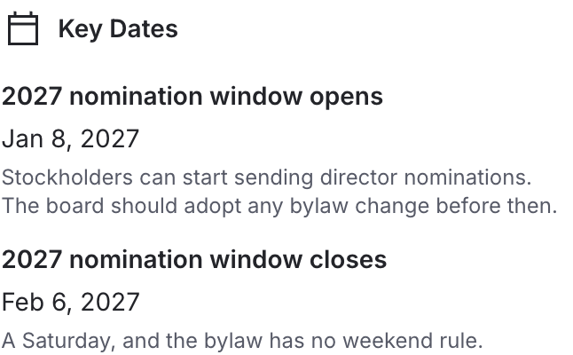
- **We have:** a MUI `Card` (Atlas-themed, fine) with `p: 0`, a redundant background, and a hand-built header row (`components/workstreams/SectionCard.tsx:26-47`). The Relevance list is a hand-built `ul`.
- **Closest Atlas:** `SectionHeader({ title, headingLevel, leadingContent, buttonArray })` for the header, and the `list` theme for the bullets.
- **Effort:** S.

### W5. Label-over-value fields
- **We have:** three hand-made "small muted label over value" patterns that disagree with each other: `textMd` emphasis in `SectionCard.tsx` and `SignalList.tsx`, `body1` emphasis in `TaskTable.tsx`.
- **Closest Atlas:** the `labelSm`/`labelLg` variants. There is no label-over-value component.
- **Effort:** S.

### W6. Plan card, owner fields and warning
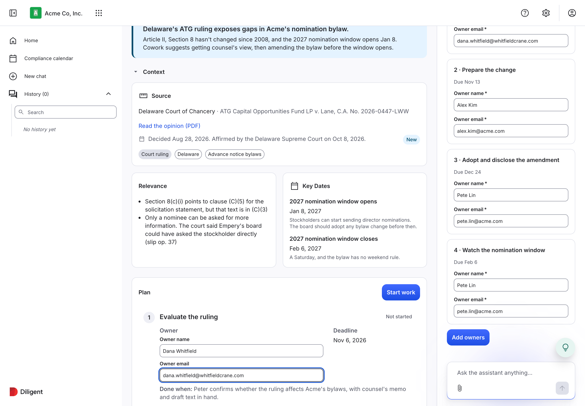
- **Compliant:** the warning is an Atlas `Alert`, the owner inputs are themed `TextField`s, and Start work is an Atlas `Button`.
- **Deviation:** the numbered badge, see W8.

### W7. Right-hand chat: A2UI owner form
- **We have:** an `A2uiSurface` that renders Atlas-themed Cards, TextFields and Buttons. It is compliant overall. Two small things: the deprecated `inputProps`, and the emphasis weight override on `h5`/`h6`.
- **Closest Atlas:** `AIChatAskUserInput` is single-question, so it is not a match for a four-task form.
- **Effort:** S.

### W8. Task number badge
- **We have:** a 28px circle with a bold number (`TaskTable.tsx:271-293`).
- **Closest Atlas:** none. `Avatar` or `badge` are the nearest, and `LinearStepper` is for flows.
- **Effort:** S, no equivalent.

---

## 4. Workstream: View (in progress)

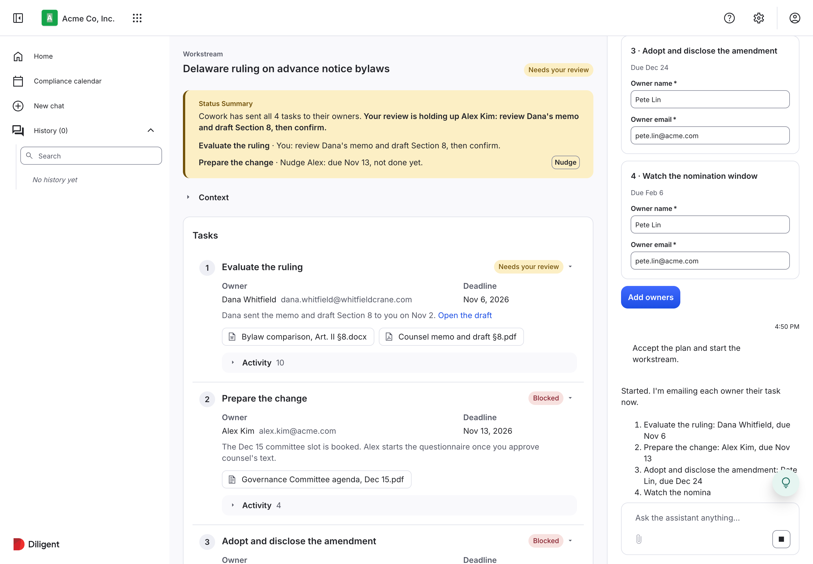

### W9. Status Summary
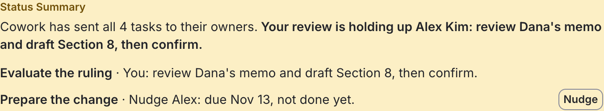
Same as W2. The Nudge button is an Atlas `xsmall` outlined `Button`, which is compliant. The panel is the deviation.

### W10. Task status switcher (your example)
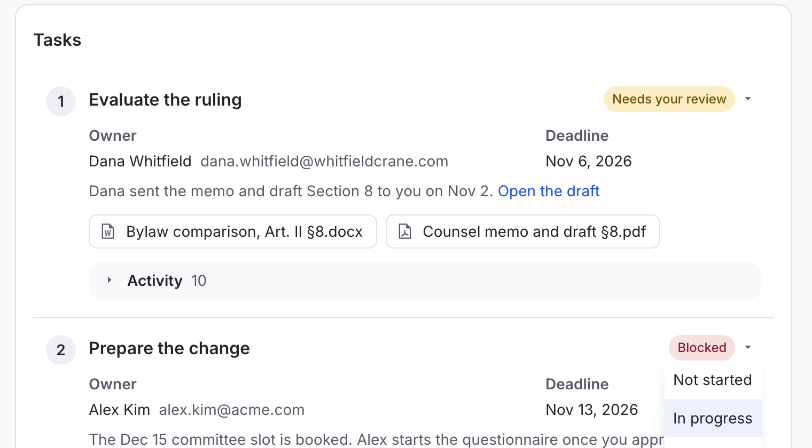
- **Correction:** it is on each task block, not the page header. The header status badge (`WorkstreamPage.tsx:463-469`) is a plain, non-interactive `StatusIndicator`.
- **We have:** a `ButtonBase` wrapping a `StatusIndicator` plus a caret icon, opening a MUI `Menu` of Not started, In progress and Done (`TaskTable.tsx:311-357`). Needs your review and Blocked are derived, so they are not options.
- **Closest Atlas:** no status-switcher component. The nearest are the `dropdown` (Select) theme, `ButtonTile` (which has a `statusIndicator` slot and an end icon), `splitButton`, or a `Button` with `endIcon` plus `Menu`.
- **To comply:** the safest route is `Button` plus `Menu` where the label is a `StatusIndicator`, with the Atlas focus state. Flag it to the Atlas team as a candidate pattern.
- **Effort:** M, and needs a design decision.

### W11. Task block
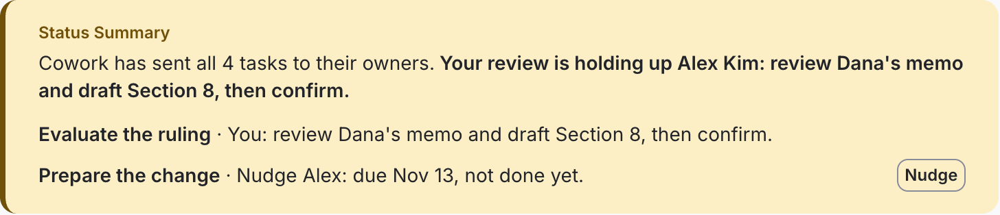
- **Compliant:** `StatusIndicator` for status, Atlas `Button`s.
- **Deviations:** the number badge (W8), the label-over-value fields (W5), the row highlight borrowing `statusIndicator.colors.information` as a tint, and a raw `28px` grid column.

### W12. File chips
- **We have:** a hand-built `ButtonBase` chip with a custom border, hover and focus ring (`DocumentChip.tsx:51-96`).
- **Closest Atlas:** `Chip` (outlined, with an icon and `onClick`). The app already uses a plain `Chip` for attachments in `ThreadMessages.tsx:121`, so the two are inconsistent. `Chip` uses a full-pill radius, so the shape will change.
- **Effort:** S.

### W13. Activity accordion
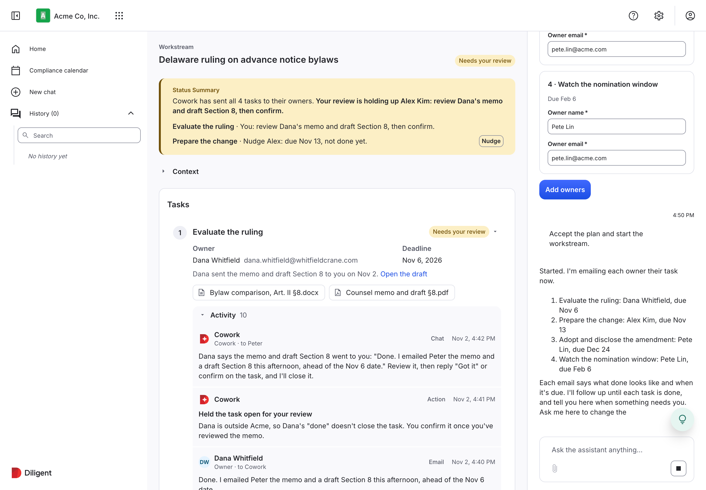
- **We have:** the same hand-built disclosure as W3: a `Box`, a `ButtonBase`, a caret and a `Collapse` (`TaskTable.tsx:215-268`).
- **Closest Atlas:** `Accordion`.
- **Also:** `StatusIndicator color="subtle"` is used as a plain kind label ("Email", "Action", "File"), which misuses a status component (`ThreadMessages.tsx`). The flat rows use a raw `2px solid` border as a divider where Atlas has `Divider` and divider tokens. The timeline filter is a text button plus `Menu` where Atlas has `FilterToolbar` or `Dropdown`.
- **Effort:** S each.

### W14. File view page (`FileView.tsx:36-72`)
- **We have:** a hand-built head: a Back text button, a 28px file icon, an `h4` and a meta line.
- **Closest Atlas:** `PageHeader` for the title and meta. The code docs show a `backButton` slot, but the design guideline says the back button on the page header **is no longer supported** and tells you not to put a back arrow on a page header, because going back now lives in the side navigation. So the hand-built Back button is itself off-pattern, and the fix is a breadcrumb (`PageHeader` has a breadcrumb slot) back to the workstream. **(rechecked)**
- **Effort:** S–M. The document renderer has no Atlas equivalent.

### W15. Context open
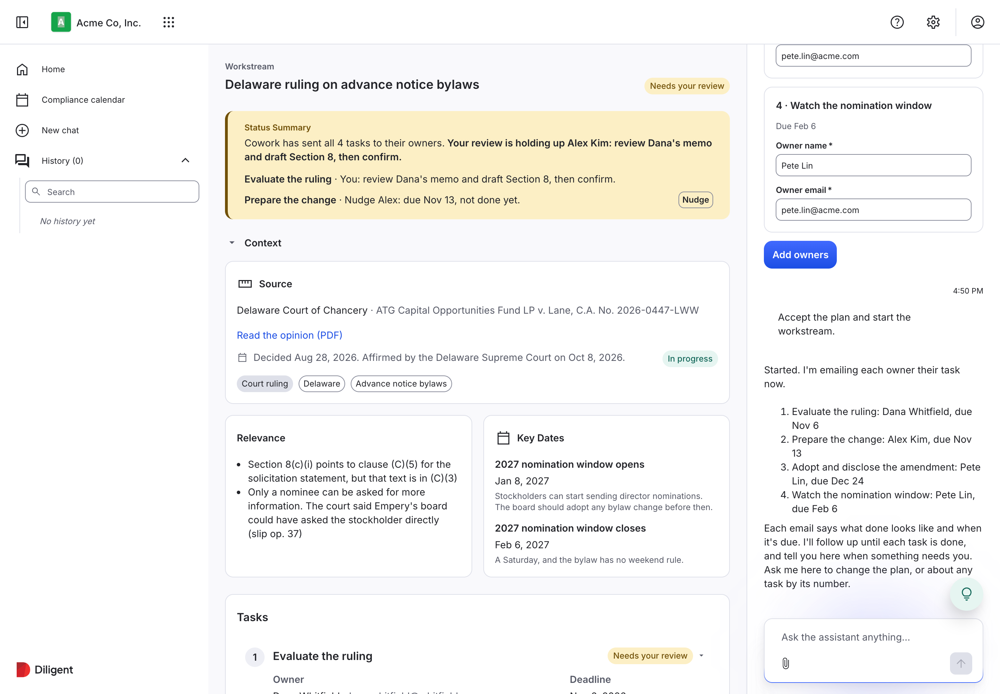
Same as W3 and W4.

---

## 5. Cowork chat panel (right side, Create and View)

### R1. Panel chrome (`SideChatLayout.tsx`)
- **We have:** a flex layout with `height: calc(100vh - 64px)` (hard-coded header height), `38%`/`32%` width with min `340` and max `520`, and a hand-drawn left border.
- **Closest Atlas:** `AIChatPanel` (title, collapse and expand, drag to float, minimized state). Per the guideline, the docked panel is attached to the right, fills the viewport height, resizes horizontally only, and has a **max width of 440px** (ours goes to 520). **(rechecked)**
- **Effort:** M–L.

### R2. Tool calls (`ToolCall.tsx`, about 390 lines)
- **We have:** hand-built tool rows and a group with a spinner, collapse, shimmer and an approve/deny state. It carries raw hex values (`#1c4ee4`, `#6e7182`, `#575a67`, `#dee0e9`, `#888b9a`), `borderRadius: 4px` and raw sizes. The comments say it matches the Figma component.
- **Closest Atlas:** `AIChatToolCall({ label, status, icon, authorization, expanded })` and `AIChatToolCallGroup({ label, status, progress })` are exported by our bundle. **(rechecked)** The Atlas "AI tool calling" guideline says this pattern is a **working draft** (in progress, not through design or dev review) and that React is "not yet built". Its anatomy matches what `ToolCall.tsx` already does (name and icon, status, expandable result, a group header, and Approve/Deny for paused calls), because both come from the same Figma ideation file.
- **To comply:** the bundle export exists, but the pattern may still change. Hold this until Atlas ships it, or swap and accept the churn. Check parity first for the download link and the branded Diligent tool icons.
- **Effort:** M. Lower priority than it looked.

### R3. "Worked for Ns" and reasoning (`AtlasChatMessage.tsx:58-124, 233-327`)
- **We have:** a hand-built disclosure with a raw hover color, `role="button"` and key handlers. The non-refreshed path uses Atlas `AIChatReasoningBlock` but overrides its label sizes, with a comment saying the released component is oversized.
- **Closest Atlas:** `AIChatToolCallGroup` or `AIChatThinkingIndicator`.
- **Effort:** S–M. Raise the oversize workaround with the Atlas team.

### R4. Suggested actions
- **We have:** a hand-built list of `ButtonBase` rows with an icon, a negative margin and a hover token (`AtlasChatMessage.tsx:337-370`).
- **Closest Atlas:** `AIChatSuggestedActions({ buttons, label })`.
- **Effort:** S.

### R5. Loading mark
- **We have:** a custom `facet-wave.svg` spinner (`BrandSpinner.tsx`).
- **Closest Atlas:** `AILoadingIndicator` or `AIChatThinkingIndicator`.
- **Effort:** S.

### R6. CSS overrides of Atlas chat (`styles.css:94-111`)
- **We have:** `display: none !important` on the message avatar and on header children, and a forced user-message border and shadow.
- **Closest Atlas:** the `AIChatMessageHeader` and `AIChatUserMessage` props. Hiding by CSS is brittle across Atlas upgrades.
- **Effort:** S.

### R7. Signal list in chat (`SignalList.tsx`)
- **Compliant:** `Card`, `StatusIndicator`, tags and `Divider`.
- **Deviations:** raw `minWidth: 200` and card padding overrides, and a repeated `Link` wrapping a `Typography` with `color: inherit` that fights the Link theme (also in the calendar and `SourceStrip`).
- **Effort:** S.

### R8. "Refreshed" demo variant (off by default)
Only active when the Demo setting is on. It carries raw hex colors, a 12px radius and a custom shadow in `AtlasChatMessage.tsx`, `AtlasChatBoxComposer.tsx` and `ToolCall.tsx`. Tokenize or remove it if it graduates from the demo.

---

## 6. Cross-cutting

- **Font-weight overrides: compliant. (rechecked, this changes the first draft.)** We set `fontWeight: tokens.semantic.fontWeight.emphasis.value` on `body1`, `h4`, `h5` and `h6` at dozens of sites. The Atlas Typography docs show the same pattern (a heading or `body1` with `fontWeight` from a token for emphasis). The tokens we use are the semantic ones; the docs use core ones. I'd drop this from the to-do list. The `label*` variants are an option, not a requirement.
- **Raw numbers.** `gap: "24px"`, `mt: "40px"`, `maxWidth` 916/960, `minWidth` 340, `lineHeight: 18px`, `letterSpacing: 0.5px`. The `SPACE` scale and `tokens.core.spacing` cover most. S.
- **Our own rules versus Atlas.** The 14px minimum in task blocks and the "step a variant down" typography note in `AGENTS.md` are app rules, not Atlas ones. They are the reason `body1` is used where Atlas's own samples use `labelLg`/`textSm`. Worth deciding whether 100% compliance means following Atlas's pairings.

## 7. Already compliant

- `ClickableCard` for the home quick actions.
- `AIChatBox` composer, `AIChatAIMessage`, `AIChatUserMessage`, `AIChatMessageTextBlock`, `AIChatSystemMessage` and the voice button.
- `AINavLink` and `AINavSection` for the side nav.
- `StatusIndicator` for statuses on tasks, signals, calendar rows and the page header.
- `Alert` for plan banners, and an Alert in `Snackbar` as the toast.
- `OwnerTypeahead` (the `AutocompletePresets.userLookup` preset) and `PersonLine` (`AvatarPresets`).
- `Chip` for tags and snooze labels, and `ToggleButtonGroup` for the calendar view switch.
- Atlas icons everywhere except the one in H10, and `tokens.semantic.*` for color, radius and font throughout.

## 8. Suggested order of work

1. **Swap-ins that need no design input (S):** `Accordion` for the Activity rows (W13, H9), expandable `SectionHeader` for Context (W3), `SectionHeader` for card headers (W4, C6, H8), `PageHeader` with a breadcrumb (W1, C6, W14), `AIDisclaimer` (H4), `AIChatSuggestedActions` (R4), `Chip` for file chips (W12), the nav icon (H10).
2. **Update the vendored bundle** (Oct 30 copy), then move the home quick-action cards and the attention card to the interactive `Card`, since `ClickableCard` is deprecated (H6, H7). `AGENTS.md` already explains how to refresh the bundle.
3. **Colors:** the calendar status dots (C1) and band accents (C7) get decided together. C1 now has a concrete token mapping.
4. **`Alert` for the status and summary panels (W2, W9),** once you decide whether to lose the 4px accent bar.
5. **Chat:** `AIChatPanel` (R1, mind the 440px max width). Hold `AIChatToolCall` (R2) until Atlas finishes the pattern.
6. **Ask Atlas** about the status switcher (W10), the date badge (C2), the multi-line event chip (C8), the task number badge (W8) and rich hover content (C9).
